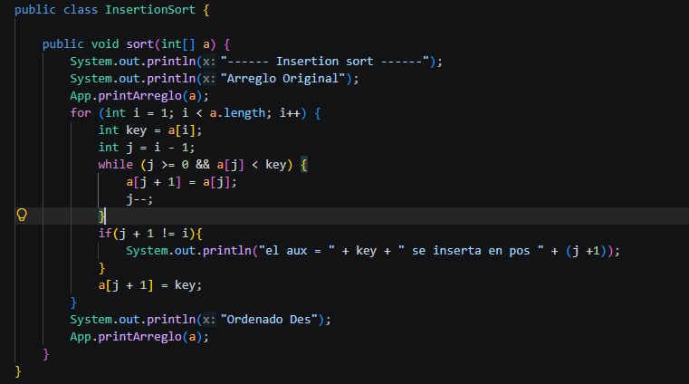
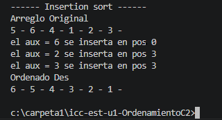

Codigo:

Resultado:

Explicacion: Lo que hice en mi codigo para lograr esa imprimesion fue aniadir un if el cual junto con un sout me ayudaria a impirmir las veces que se cambiaba de posisicon cada numero, tmabien llame a mi arreglo y metodo desd el main, en cual copie el arreglo original en 2 copias difenrest para evitar que al siguiente metodo que trabajara con el mismo arreglo le llegara un arreglo ya ordenado