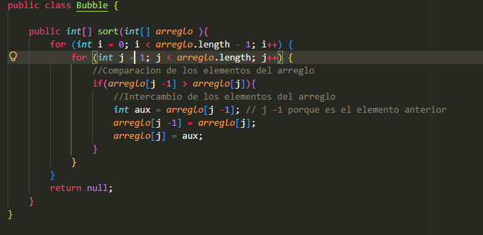

CODIGO

en mi codigo arregle 4 variables 2 primeras que son contadores para contar los cambios y comparaciones y otras 2 para que guardes el datos del numero que fue intercambiado para asi podelo imprimir son un sout en consola. 

Resultado:

